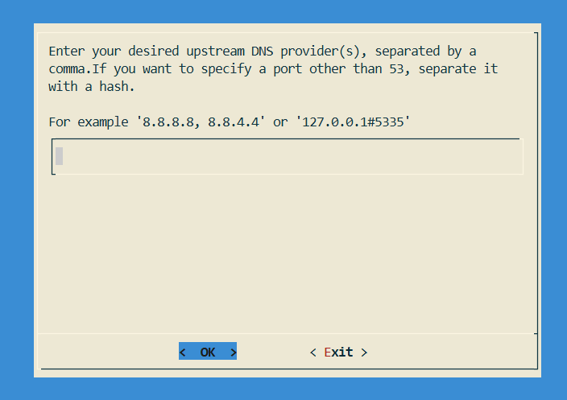
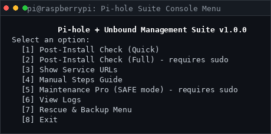
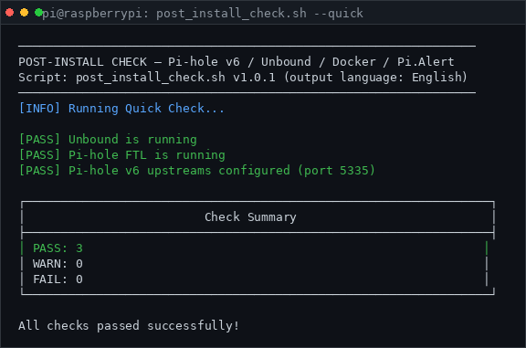

<div align="center">

# 🛡️ Pi-hole + Unbound

## **Ein-Klick DNS-Sicherheits-Stack**

[](LICENSE)
[](https://pi-hole.net/)
[](https://nlnetlabs.nl/projects/unbound/)
[](https://debian.org/)
[](https://python.org/)
[](https://buymeacoffee.com/timintech)


**🌐 Sprachen:** 🇩🇪 Deutsch (diese Datei) • [🇬🇧 English](README.md)

</div>

---

## ✨ Worum es geht

Ein **produktionsbereiter Installer und Management-Suite** für Pi-hole + Unbound auf dem Raspberry Pi.

**DNS-Kette:**
```
Client → Pi-hole (Port 53) → Unbound (Port 5335) → Internet
```

Pi-hole blockiert Werbung und Tracker. Unbound löst DNS-Anfragen rekursiv auf — ohne externen DNS-Resolver, mit vollständiger DNSSEC-Validierung.

## Projektstatus und letzte Aktualisierung

**Dokumentation zuletzt geprüft:** 2026-10-28

**Letztes Projektupdate:** 2026-10-28 — [PR #37](https://github.com/TimInTech/Pi-hole-Unbound-PiAlert-Setup/pull/37) behebt die Upstream-Erkennung unter dem Systemd-Hardening. Die README-Aktualisierung und Bereinigung veralteter Artefakte stehen in [PR #35](https://github.com/TimInTech/Pi-hole-Unbound-PiAlert-Setup/pull/35); Dashboard und Wartungsoberfläche sind in [PR #32](https://github.com/TimInTech/Pi-hole-Unbound-PiAlert-Setup/pull/32), [PR #33](https://github.com/TimInTech/Pi-hole-Unbound-PiAlert-Setup/pull/33) und [PR #34](https://github.com/TimInTech/Pi-hole-Unbound-PiAlert-Setup/pull/34) dokumentiert.

- Das lesende DNS-Dashboard wurde mit der authentifizierten Wartungsoberfläche integriert.
- Updates wurden abgesichert, DNS-Logzeilen begrenzt, der API-Key aus dauerhaftem Browser-Speicher entfernt und der Logzugriff auf eine Leseberechtigung beschränkt.
- Der Test-Workflow verwendet nur noch schreibgeschützte Repository-Berechtigungen.
- DNS-/DNSSEC-Verhalten, beide Weboberflächen und authentifizierte API-Routen wurden produktiv geprüft.

NetAlertX ist optional. Bei der letzten Produktionsprüfung war es nicht eingerichtet; `/devices` meldet daher HTTP 503, statt eine leere Geräteliste vorzutäuschen. Pi-hole-/Unbound-Monitoring und DNS funktionieren unabhängig davon. Die Änderungshistorie steht in [CHANGELOG.md](CHANGELOG.md).

---

## ⚡ Schnellstart

```bash
git clone https://github.com/TimInTech/Pi-hole-Unbound-PiAlert-Setup.git
cd Pi-hole-Unbound-PiAlert-Setup
chmod +x install.sh
sudo ./install.sh
```

> Als **normaler Nutzer** klonen (z.B. `pi`), nicht als root. Der Installer wird via `sudo ./install.sh` ausgeführt.

Für eine bereits laufende Suite mit Wartungsoberfläche aktualisiert `sudo ./install.sh --upgrade-only` ausschließlich Suite- und Webdateien. DNS-Konfiguration und Python-Environment bleiben erhalten; Voraussetzungen und Rollback stehen in [docs/MAINTENANCE_WEB.md](docs/MAINTENANCE_WEB.md).

---

## ✅ Voraussetzungen

| Anforderung | Details |
|---|---|
| **Plattform** | Raspberry Pi 3/4/5, Debian Bookworm/Trixie (64-bit) |
| **Pi-hole** | v6.x (wird durch dieses Script installiert) |
| **Unbound** | Wird installiert und auf Port 5335 konfiguriert |
| **Python** | 3.10+ (für optionale Suite API und Wartungsoberfläche) |
| **Nutzer** | Normaler Nutzer mit sudo |

Abhängigkeiten manuell installieren (optional):
```bash
sudo apt-get update
sudo apt-get install -y unbound unbound-host unbound-anchor dns-root-data \
  ca-certificates curl dnsutils iproute2 python3 python3-venv python3-pip \
  git openssl sqlite3 jq
```

Installiere zusätzlich `docker.io`, wenn du das optionale NetAlertX oder den containerisierten Pi-hole-Modus verwenden willst.

---

## 🔴 Kritisch: Pi-hole muss Unbound als Upstream verwenden

> Ohne diese Einstellung ist das Setup funktional kaputt — DNSSEC wird umgangen und es wird ein externer Resolver genutzt.

Pi-hole muss DNS-Anfragen an Unbound auf **127.0.0.1#5335** weiterleiten.

**Prüfen via Pi-hole Admin → Settings → DNS:**



**Oder via Installer / Rescue Menu:**
```bash
sudo pihole-rescue   # Option 9: Pi-hole → Unbound Standardfix
```

---

## 🖥️ Management-Tools

Dieses Repo enthält drei komplementäre Verwaltungsinterfaces:

### 1. Console Menu (`scripts/console_menu.sh`)

Allgemeines interaktives Menü für die tägliche Verwaltung.

```bash
bash ~/Pi-hole-Unbound-PiAlert-Setup/scripts/console_menu.sh
# oder im Text-Modus (kein dialog):
bash ~/Pi-hole-Unbound-PiAlert-Setup/scripts/console_menu.sh --text
```



| Option | Aktion |
|--------|--------|
| 1 | Post-Install Check (Schnell) |
| 2 | Post-Install Check (Vollständig) — sudo |
| 3 | Service-URLs anzeigen |
| 4 | Manuelle Schritte-Anleitung |
| 5 | Maintenance Pro — sudo |
| 6 | Logs anzeigen |
| **7** | **Rescue & Backup Menu** |
| 8 | Beenden |

---

### 2. Rescue & Backup Menu (`scripts/rescue_menu.sh`)

Eigenständiges Wiederherstellungs- und Diagnosetool. Global aufrufbar:

```bash
sudo pihole-rescue
```

| Option | Aktion |
|--------|--------|
| 1 | Systemstatus (Services, DNS, Ports, Temperatur) |
| 2 | DNS-Loop / Upstream-Check |
| 3 | Nightly / Diagnosetest |
| 4 | Backup erstellen (pihole.toml + Unbound + systemd) |
| 5 | Backup wiederherstellen |
| 6 | Alte Backups löschen |
| **7** | **Last-Known-Good wiederherstellen** |
| **8** | **Emergency DNS Bypass** (Pi → 8.8.8.8/1.1.1.1, reversibel) |
| **9** | **Pi-hole → Unbound Standardfix** |
| 10 | Router / Client DNS-Hinweis (FritzBox-Anleitung) |
| 11 | Letzten Report / Log anzeigen |
| 0 | Beenden |

---

### 3. Maintenance Pro (`tools/pihole_maintenance_pro.sh`)

Batch-Wartungsscript (apt-Updates, Pi-hole-Update, Gravity-Update, Sicherheits-Scan).

```bash
sudo bash tools/pihole_maintenance_pro.sh
# mit Flags:
sudo bash tools/pihole_maintenance_pro.sh --no-apt --no-upgrade
```

Flags: `--no-apt`, `--no-upgrade`, `--no-gravity`, `--restart-ftl`, `--backup`, `--json`

---

## 📁 Repository-Struktur

```
Pi-hole-Unbound-PiAlert-Setup/
├── install.sh                     # Host-/Container-Installer
├── start_suite.py                 # Optionale API und DNS-Dashboard
├── maintenance_web.py             # Wartungsoberfläche und Session-Sicherheit
├── maintenance_runner.py          # Privilegierter Wartungs-Runner
├── maintenance_backups.py         # Verifizierte Backups
├── maintenance_config.py          # Caddy-/LAN-Konfiguration
├── maintenance_install.py         # Einrichtung der Wartungsoberfläche
├── requirements.txt               # Python-Abhängigkeiten
├── .env.example                   # Umgebungsvariablen-Vorlage
├── dashboard/                     # Lesendes DNS-Monitoring-Dashboard
├── web/                           # Assets der Wartungsoberfläche
├── deploy/                        # systemd-, Caddy- und sudo-Dateien
├── scripts/
│   ├── install_maintenance_web.sh # Gestufter Installer
│   ├── rollback_maintenance_web.sh # Geprüfter Deployment-Rollback
│   ├── console_menu.sh            # Interaktives Verwaltungsmenü
│   ├── rescue_menu.sh             # Rescue- und Backup-Menü
│   └── lib/ui.sh                  # Gemeinsame Shell-UI
├── tools/pihole_maintenance_pro.sh # Batch-Wartungsscript
├── tests/                         # Python-, Shell-, Browser- und Upgrade-Tests
├── docs/                          # Betrieb, Entwürfe, Berichte, Screenshots
├── CHANGELOG.md
└── README.md
```

---

## ⚙️ Post-Install Verifikation

```bash
# Schnellcheck (kein sudo)
bash scripts/post_install_check.sh --quick

# Vollständiger Check (sudo)
sudo bash scripts/post_install_check.sh --full
```



---

## 🆘 Rescue-Operationen

### Emergency DNS Bypass
Wenn Pi-hole oder Unbound kaputt ist und kein DNS funktioniert:

```bash
sudo pihole-rescue   # Option 8: Emergency DNS bypass
```

Setzt den Pi direkt auf 8.8.8.8/1.1.1.1. **Vollständig reversibel** — die vorherige Konfiguration wird gespeichert und kann wiederhergestellt werden.

### Last-Known-Good Wiederherstellen
Stellt das letzte bekannt-funktionierende Backup wieder her und prüft DNS:

```bash
sudo pihole-rescue   # Option 7: Last-Known-Good
```

### Backup / Restore
```bash
sudo pihole-rescue   # Option 4: Backup erstellen
sudo pihole-rescue   # Option 5: Backup wiederherstellen
```

Backups werden in `/home/pi/pihole-rescue-backups/` gespeichert und enthalten:
- `/etc/pihole/pihole.toml`
- `/etc/unbound/unbound.conf.d/`
- Systemd Drop-in Dateien

---

## 🐍 Optional: Suite REST API & Dashboard

`start_suite.py` ist eine **optionale** FastAPI-Anwendung für Monitoring.
Es enthält auch ein modernes, responsives **Dashboard** zur Überwachung Ihres DNS-Stacks.

- **Dashboard-Zugriff**: Auf einem eingerichteten Host über Caddy unter `https://<pihole-host>:8443/dashboard/`. Lokal für die Entwicklung unter `http://127.0.0.1:8090/dashboard/`.
- **Wartungsoberfläche**: Der Root-Pfad `https://<pihole-host>:8443/` zeigt die separate Wartungsoberfläche, wenn sie aktiviert ist.
- **Fernzugriff**: Die API bindet an `127.0.0.1:8090`. Diesen Port nicht direkt freigeben; Caddy-LAN-Zugriff oder SSH-Tunnel verwenden.
- **Authentifizierung**: Für das Dashboard-Login und die API-Endpunkte ist der `SUITE_API_KEY` erforderlich.
- Der Schlüssel bleibt nur im Speicher der Browserseite. Nach einem Neuladen ist eine erneute Anmeldung nötig.

```bash
# Konfiguration
cp .env.example .env
nano .env   # SUITE_API_KEY setzen

# Abhängigkeiten
python3 -m venv .venv && source .venv/bin/activate
pip install -r requirements.txt

# Starten
set -a
. ./.env
set +a
python3 start_suite.py
# Die API bleibt auf 127.0.0.1:8090; die Produktivdokumentation ist deaktiviert.
```

Das DNS-Dashboard zeigt Gesamtstatus, Pi-hole-FTL-Status und Version, Upstreams
und die Zahl gelesener Anfragen aus den letzten 100 Logeinträgen; Unbound-Status,
Port und DNS-Prüfung; optionale NetAlertX-Erreichbarkeit; sowie Laufzeit, Version
und Host-IP der Suite-API. Fehlende Daten erscheinen als nicht verfügbar, nicht
als Null. Die API bietet `/health`, `/version`, `/urls`, `/pihole`, `/unbound`,
`/netalertx`, `/stats`, `/dns`, `/leases` und `/devices`. Die Wartungsendpunkte
liegen unter `/api/session` und `/api/maintenance/`. Geräteerkennung antwortet
mit HTTP 503, solange keine NetAlertX-Integration eingerichtet ist.

Die Wartungsoberfläche zeigt den letzten Auftrag, seine Prüfschritte und eine
Systemmomentaufnahme. Sie kann Systemchecks, verifizierte Backups (bis zu 10,
mit Download und Löschung) sowie kontrollierte Updates ausführen. Eine
Wiederherstellung läuft lokal nach der dokumentierten Recovery-Anleitung, nicht
im Browser.

**Nicht erforderlich** für den Kern-Stack (Pi-hole + Unbound).

### Sichere Wartungsoberfläche

Die optionale Wartungsoberfläche bietet Systemcheck, verifizierte Backups,
kontrollierte Updates, das letzte Auftragsergebnis, eine Systemmomentaufnahme
und Prüfschritte. Sie bleibt standardmäßig deaktiviert. Bei einer neuen
Host-Installation wird sie so aktiviert:

```bash
sudo ./install.sh --with-maintenance-web
```

Eine bestehende Installation mit Wartungsoberfläche wird mit
`sudo ./install.sh --upgrade-only` aktualisiert. Die Browser-Anmeldung nutzt
den bestehenden `SUITE_API_KEY`.

Siehe [docs/MAINTENANCE_WEB.md](docs/MAINTENANCE_WEB.md) für Voraussetzungen,
Zertifikatvertrauen, Sicherheitsgrenze und Rollback.

---

## 🌐 Optional: NetAlertX

Netzwerk-Gerätemonitoring (separate Installation):

```bash
sudo ./install.sh --with-netalertx
```

Ohne NetAlertX ist die Geräteerkennung nicht verfügbar. DNS-Monitoring und
Pi-hole-/Unbound-Betrieb funktionieren weiterhin.

---

## 🔎 Manueller Update-Check

Der Host-Pi-hole-Installer nutzt den offiziellen Installer von `https://install.pi-hole.net` und pinnt keine Patch-Version. Der Container-Modus nutzt `pihole/pihole:latest`; NetAlertX nutzt `jokobsk/netalertx:latest`.

Diese Checks nur manuell in einem Wartungsfenster ausführen:

```bash
pihole -v
sudo pihole -up
apt list --upgradable
docker pull jokobsk/netalertx:latest
```

Vor Updates auf einem produktiven Raspberry Pi das Rescue Menu nutzen oder ein Backup erstellen.

---

## 🔧 Fehlerbehebung

### DNS funktioniert nicht
```bash
sudo pihole-rescue   # Option 2: DNS-Check, oder Option 8: Bypass
```

### Pi-hole nutzt nicht Unbound
```bash
sudo pihole-rescue   # Option 9: Pi-hole → Unbound Fix
```

### Systemstatus prüfen
```bash
systemctl status pihole-FTL unbound
dig +short @127.0.0.1 google.com
dig +short @127.0.0.1 -p 5335 google.com
```

### Vollständige Diagnose
```bash
sudo bash scripts/post_install_check.sh --full
sudo bash scripts/nightly_test.sh
```

---

## 🛡️ Sicherheitshinweise

- Die Suite API bindet standardmäßig nur an **127.0.0.1**
- Immer einen starken `SUITE_API_KEY` setzen
- Pi-hole Admin-Interface ist durch Pi-holes eigene Authentifizierung geschützt
- Unbound läuft auf Port 5335 (nicht extern erreichbar ohne explizite Konfiguration)
- Sicherheitslücken melden: [SECURITY.md](SECURITY.md)

---

## 📜 Lizenz

[MIT License](LICENSE) — © TimInTech
